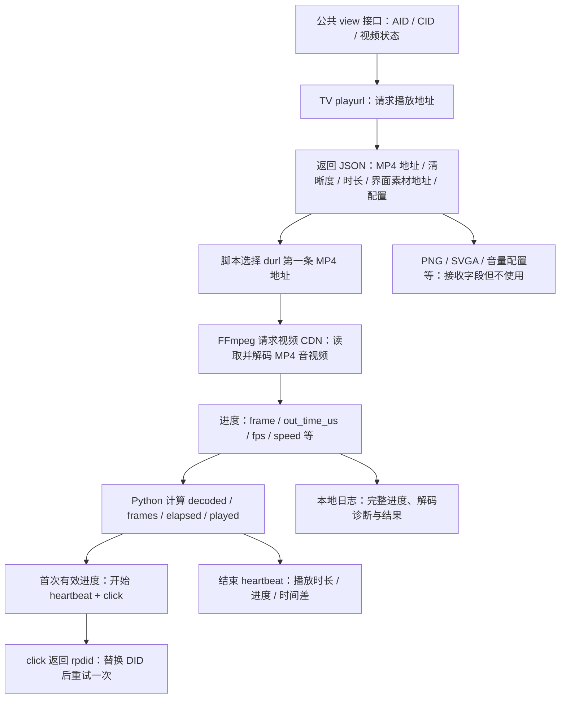

# TV 接口返回资源、运行变量与后台回传

依据：2026-11-07 10:21:23～10:21:37 的真实运行 `BV1Gq486CEK4`，目录 `.debug-runs/20261107-102123-717ffc/`，及其 `state.json.private_dir` 中保存的请求、响应、FFmpeg 日志。此文描述当前 Python 脚本；不能据此推断完整 TV App 会加载的全部资源，也不能确认平台内部的入库、关联、风控或计数规则。本次分析复用已有记录，没有重新播放。

## 1. 实际数据流



这里有两条对外数据通道：一条是 API 查询与主动上报；另一条是 FFmpeg 向视频 CDN 请求媒体。下载请求本身也会向 CDN 发送 URL 参数和网络请求元数据，但它与 heartbeat/click 是不同的请求。

## 2. playurl 实际返回了哪些资源

| 返回项 | 本次值或内容 | 当前脚本的动作 |
| --- | --- | --- |
| `durl[0].url` | `cn-gddg-ct-01-10.bilivideo.com` 上的 `/upgcxcode/90/91/43360849190/43360849190-1-192.mp4`，附带签名等查询参数 | 交给 FFmpeg，实际读取并解码 |
| `durl[0].length` | 2694536 毫秒 | 不直接使用该字段；程序采用顶层 `timelength` |
| `durl[0].size` | 412125670 字节，约 393 MiB | 整段资源的标称大小；不用于本次下载量统计 |
| `durl[0].order` | 1 | 未用于逻辑判断 |
| `durl[0].backup_url` | null | 未使用；代码没有备用 URL 切换机制 |
| `dash` | null | 本次不是独立音视频 DASH 资源；脚本只处理单条 durl |
| `wild_vision.banner.pre_icon` | `i0.hdslb.com` 的 PNG | 地址存在于返回 JSON，但未请求图片 |
| `wild_vision.banner.post_icon` | `i0.hdslb.com` 的另一张 PNG | 未请求 |
| `wild_vision.switch_motion` | `i0.hdslb.com` 的 SVGA 动画 | 未请求，也不执行动画逻辑 |
| `wild_vision.switch_toast_frame` | `i0.hdslb.com` 的 PNG | 未请求 |

FFmpeg 日志确认这个 MP4 内含两条媒体流：

- 视频：H.264 High，1280×720，30 fps，标称约 1147 kb/s。
- 音频：AAC LC，48 kHz，立体声，标称约 62 kb/s。

本次解码 8 秒，不代表下载了整个 412 MB 文件，也不能把解码时长直接换算为网络传输量。FFmpeg 可能缓冲、预读或按范围请求；本次没有保存逐个 CDN HTTP 请求、Range、重定向链或网络字节计数，所以这些数值不能从现有记录精确恢复。日志中的 `audio:1500KiB` 是解码后输出统计，也不是音频下载流量。

程序没有后续请求这些 PNG/SVGA，也没有弹幕、字幕、广告或推荐列表加载逻辑。完整 TV App 是否另有这些行为，需要针对实际 App 的网络和运行记录另行分析。

## 3. 返回的配置哪些真正参与了逻辑

| 返回字段 | 本次值 | 在代码中的使用 |
| --- | --- | --- |
| `quality` | 64，即本次 720P 档位 | 保存到 item，并作为 heartbeat 的 quality；请求时 qn=16，但后续采用实际返回的 64 |
| `timelength` | 2694536 | 除 1000 得到 duration=2694.536 秒，限制目标时长，心跳发送 floor(duration)=2694 |
| `is_drm` | false | 为真则拒绝播放 |
| `is_preview` | 0 | 为真则拒绝播放 |
| `durl` / `durl[0].url` | 只有一个可用 MP4 地址 | 要求恰好一条媒体记录且 URL 非空，随后启动 FFmpeg |
| `format`、`accept_quality`、`support_formats`、`video_codecid` | mp4720 / [64] / 720P 信息 / 7 | 保留在响应中，但没有驱动额外下载或上报 |
| `volume.*` | 响度、峰值、目标响度等配置 | 未应用到 FFmpeg，也没有回传这些测量字段 |
| `seek_param`、`seek_type` | start / second | 脚本未据此实现拖动或跳转 |
| `is_login`、`is_vip`、付费/会员字段 | 本次未登录、非 VIP | 不用这些字段构造账号信息；上报 mid 固定为 0 |
| `telecom_ext.*` | need_report=false、watch_network_change=false 等 | 当前脚本没有对应的运营商上报或网络监听分支 |
| `enable_p2p_upload` | false | 脚本本身也没有 P2P 上传实现 |
| playurl 返回的 `aid` / `cid` | 均为 0 | 没有用于上报；真实内容 ID 来自此前 view 查询 |

返回 JSON 会整体读入 `result`，但“变量里存在某字段”不等于脚本执行了该字段指向的动作。

## 4. 变量从哪里来，回传到哪里

| 变量或字段 | 来源 / 本次值 | 发往哪里 |
| --- | --- | --- |
| `aid` | view 返回 117564847951309 | playurl 中名为 object_id；heartbeat/click 中名为 aid |
| `cid` | view 返回 43360849190 | playurl、heartbeat、click |
| `bvid` | 用户输入与 view 返回 BV1Gq486CEK4 | 公共 view 查询及本地记录；这次 TV 上报正文采用 AID/CID，不另发 bvid |
| `buvid` | 运行前由随机合成 MAC 计算，一次运行复用 | TV API 的 Buvid 请求头；本次 CDN URL 的 buvid 参数也与它一致 |
| 初始 `did` | 同一合成 MAC 生成的本地 DID | 首次 click 正文；不直接放入 heartbeat 正文 |
| `rpdid` / 新 `did` | 首次 click 的响应 data.rpdid | 更新 run_state.did，作为第二次 click 的 did；其余 click 业务参数不变 |
| `session` | 本次播放生成的 uuid4().hex | 两次 heartbeat 与两次 click 都携带相同值 |
| `ftime` | 建立这次运行时的秒级时间，1794018083 | click |
| `start_ts` | 首次有效解码进度时计算 int(time.time() - decoded)，1794018088 | heartbeat 的 start_ts；click 中用 stime |
| `ts` | 每个 GET / FORM 签名时的当前时间 | playurl 查询串与 heartbeat 表单；不是逐次追加给 CLICK 的同名字段 |
| `duration` | playurl.timelength / 1000，2694.536 | heartbeat 取整为 2694 |
| `quality` | playurl 返回 64 | heartbeat |
| `decoded` | FFmpeg out_time_us / 1000000，最终 8.0 | 不以 decoded 名称直接上传；参与 played_time 和进度值计算 |
| `frames` | FFmpeg frame，最终 239 | 本地进度与结果；没有作为上报字段 |
| `elapsed` | 从启动解码前开始的 monotonic 墙钟差，最终 12.187 | heartbeat total_time 取整为 12；参与 paused_time 与 played 的计算 |
| `played` | floor(min(decoded, elapsed))，最终 8 | heartbeat 的 played_time、last_play_progress_time、max_play_progress_time |
| `paused_time` | max(0, 整数 elapsed - played)，最终 4 | heartbeat；这是算法时间差，不是独立检测的手动暂停时长 |
| `first_frame` / `first_frame_epoch` | 首次同时观察到 frames>0 和 decoded>0 | 本地控制与记录；触发开始心跳及 click，不以这些字段名上传 |
| `fps`、`speed`、`dup_frames`、`drop_frames` | FFmpeg 的进度输出 | 本地 progress.jsonl；未送入上报 payload |
| `media_host`、`media_url_sha256` | 从 CDN 地址提取主机名、计算 SHA-256 | 本地结果；未作为 heartbeat/click 字段 |
| `before_view` | view.stat.view，本次为 1092 | 本地记录；不回传 |
| `ffmpeg_exit`、`audio_decoded`、decoder PID | 本地进程和日志检查 | 本地成功判定与状态；不作为上报字段 |

Buvid、DID 和 session 可以提供客户端/会话关联标记，但只能确认它们被发送，不能从客户端证据确认平台数据库具体用哪种关联键。合成 MAC 仅用于本地生成标识，程序没有另发一个原始 MAC 参数。

## 5. 首帧之后到底上报什么

### 5.1 heartbeat：播放时长与进度

目的地址：`https://api.bilibili.com/x/report/heartbeat/mobile`。POST 表单，额外加入公共客户端参数、appkey、ts 和 sign，带 User-Agent 与 Buvid 请求头。

| 字段 | 开始心跳 | 结束心跳 |
| --- | --- | --- |
| `aid` / `cid` | 117564847951309 / 43360849190 | 相同 |
| `session` | 本次随机 session | 相同 |
| `start_ts` | 1794018088 | 1794018088 |
| `quality` | 64 | 64 |
| `duration` | 2694 | 2694 |
| `played_time` | 0 | 8 |
| `total_time` | 0 | 12 |
| `paused_time` | 0 | 4 |
| `last_play_progress_time` | 0 | 8 |
| `max_play_progress_time` | 0 | 8 |
| `ts` | 1794018089 | 1794018096 |

开始心跳虽然填写 0，但发送时已经读到第一份有效 FFmpeg 进度，本次该份进度为 30 帧、1.515333 秒。这里的 0 是“开始事件”的代码约定。

其余 heartbeat 业务字段包括：`mid=0`、`sid=0`、`epid=0`、`type=3`、`sub_type=0`、`play_mode=1`、`playlist_type=''`、`playlist_id=''`、`device=master`、`auto_play=0`、`play_type=1`、`network_type=1` 和 `extra`。这些枚举/固定值是代码填写的；不能把 network_type=1 当成本次真实网络类型的测量结果。

公共参数为 `platform=android`、`mobi_app=android_tv_yst`、`build=108900`、`channel=master`、`sys_ver=28`、`brand=xiaomi`、`model=MiTV-ASTP0`、`teenager_mode=0`、`child_lock=0`。虽然程序运行在 Windows，仍发送这些模拟 TV 客户端参数。

两个 heartbeat 响应都包含 `data.ts=1794018088`。本脚本只检查成功返回，没有用响应 ts 校准时钟或生成额外请求。

### 5.2 click：播放开始事件与身份

目的地址：`https://api.bilibili.com/x/report/click/android/tv`。POST 二进制正文，参数先签名、填充、AES-CBC 加密，带 User-Agent 与 Buvid 请求头。

业务参数包含：

```text
aid, cid, mid, sid, epid, type, sub_type, play_mode,
session, playlist_type, playlist_id, device, auto_play,
appkey, platform, mobi_app, build, part, lv,
ftime, stime, ogv_copyright_index, extra, did
```

`part=0`、`lv=0`、`ogv_copyright_index=''` 为固定值。加密之前会在正文内再追加 SHA-256 `sign`。本次 click 不带 played_time、frames 或 fps。

首个 click 携带本地 DID，服务端返回 API 14013 和 rpdid。脚本验证 rpdid，更新状态，并仅把 payload.did 换成返回值重发一次。两份记录核对后，业务参数差异只有 `did`；AID、CID、session、ftime、stime 保持一致。第二次返回 code=0。

这条 CLICK 分支没有将 `TVClient.common` 全量合并进正文；不要把 heartbeat 最终表单的 brand/model/sys_ver 等字段也误认为 click 正文必有。其 User-Agent 本身仍包含 TV 客户端和设备描述。

### 5.3 extra 的内容

`extra` 是单引号键值对字符串，不是标准 JSON。heartbeat 通过表单编码传输，click 先做 quote_plus 编码再加入加密正文。

```text
session_id='', resource_id='', internal_trackid='', section_id='',
guest_id='', resource_from='1', is_preview='0', watch_right='',
section_type='', ott_track_id='', session_more='', teenager_mode='0'
```

函数虽接收 session 参数，但当前实现没有把它放入 extra.session_id；真正的 session 在顶层业务字段。

## 6. CDN 收到什么

FFmpeg 使用 playurl 返回的完整 URL，并设置 TV User-Agent。本次 URL 中的查询字段为：

```text
e, oi, mid, og, nbs, uipk, platform, trid, gen, os,
deadline, upsig, uparams, cdnid, bvc, nettype, bw, lrs,
V, qn_dyeid, agrr, buvid, build, dl, f, orderid
```

这些字段由接口返回的 URL 携带，脚本没有逐个生成或改写。已核对 `buvid` 与当前客户端一致，`platform=android_tv_yst`、`build=108900`、`mid=0`。其他不透明字段不能仅凭名字准确确定后台含义。

CDN 接收到请求的 URL 和请求元数据，连接层还会暴露实际网络出口地址；是否落日志、保存多久、是否与 API 事件关联，现有记录不能证明。脚本没有给 FFmpeg 单独设置 Buvid HTTP 请求头，本次 Buvid 是 URL 参数携带的。

## 7. 这次请求时序

| 本地时间 | 请求 / 行为 | 结果 |
| --- | --- | --- |
| 10:21:23～24 | 两次公共 view 查询，分别解析与校验视频身份 | 得到真实 AID/CID |
| 10:21:24 | TV playurl | HTTP 200 / code=0，返回 MP4 和配置 |
| 随后 | FFmpeg 读取 CDN MP4，解码媒体 | 具体每条 HTTP 事务没有抓包记录 |
| 10:21:29 | 开始 heartbeat，时长/进度字段为 0 | HTTP 200 / code=0 |
| 10:21:30 | 首次 click，发送初始 DID | HTTP 200 / code=14013，返回 rpdid |
| 10:21:30 | 第二次 click，仅替换 DID | HTTP 200 / code=0 |
| 10:21:36 | 结束 heartbeat，played=8 / total=12 / paused=4 | HTTP 200 / code=0 |
| 10:21:37 | 本地完成状态落盘 | completed |

时间来自本地记录，不是服务器收包时间；首个 API 事件中的 at 在发请求之前生成。上述历史样本只有开始和结束心跳。2026-11-08 新增可选 15 秒周期心跳试验，以实际解码进度和单调时钟双重限制；停滞不重复、延迟不补发、临近结束合并到收尾心跳。周期失败保留记录并继续解码，最终标记上报未确认；这不是已经验证的官方客户端周期规范。

## 8. 后台采集能确认到什么程度

能确认：客户端发出了内容身份、客户端描述、匿名客户端标记、会话、开始时间、清晰度、视频总时长、已播放时长和进度等数据；服务器返回了上述 HTTP/API 结果。

合理用途包括内容访问分析、播放时长/进度分析、客户端版本或设备分类，以及身份/会话关联，但这是按字段含义作出的解释。实际后台是否入库、是否去重、是否视作有效观看、是否加入公开播放量，不能由 code=0 单独证明。

完整的资源地址清单（去掉签名参数值）、响应叶字段处理分类、最终表单字段与 click 参数已另存为 `TV接口数据流明细.json`，可用来逐字段检查。原始带签名媒体地址仍在既有私有日志中，不复制到此说明。
