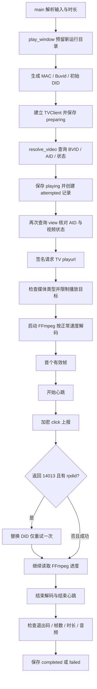

# 代码能力与运行过程

审阅日期：2026-11-07。范围：本目录的四个原始 Python 模块。以下按实际代码说明；注释引用的 APK、验证向量、实验资料未包含在当前包中，因此不能仅凭这些注释确认与所有客户端版本完全一致。

## 1. 这个程序做什么

它是一个命令行的单视频后台播放脚本，模拟指定版本 TV 客户端的请求参数：解析视频身份，取得 TV 播放地址，用 FFmpeg 按接近真实时间的速度解码音视频，在首帧解码之后发起播放上报，结束时发送一次心跳，并保存结果。

**不会弹出视频窗口，也不会通过扬声器播放声音。** FFmpeg 的输出是 `-f null -`，解码后的音视频数据被丢弃。它也不是网页自动化工具，不启动哔哩哔哩网站，不使用 ADB，不连接电视，不登录账号，不读取浏览器 Cookie。

`completed` 的含义是这次脚本流程符合其解码和接口检查条件。它不代表公开播放量一定增加，当前实现也没有自动证明二者的因果关系。

## 2. 原始模块分工

| 文件 | 职责 | 关键入口 |
| --- | --- | --- |
| `tv_playback.py` | 参数解析、公共查询、TV 请求、解码、上报、状态和实验报告 | `main`、`play_window`、`play_one`、`TVClient.request` |
| `local_signing.py` | 本地 TV GET / 表单请求签名 | `sign_query` |
| `buvid_lab.py` | 随机合成 MAC、按来源生成 Buvid | `generate_mac`、`generate_buvid` |
| `did_lab.py` | 设备字段规范化、本地 DID 编码、配对身份生成 | `did_plaintext`、`encode_did`、`generate_local_identity` |

新增的 `playback_runtime.py` 只处理 FFmpeg 定位和跨平台文件锁。新增的 `debug_server.py`、`debug_worker.py`、`debug_ui/` 负责观察环境，不承担批量播放业务。

## 3. 当前能力和边界

| 能力 | 实际行为及限制 |
| --- | --- |
| 视频标识输入 | 原始 CLI 接受 `BV` + 10 位字母数字、`av` + 正整数、纯数字 AID。调试面板额外接受 bilibili.com 视频完整链接并提取标识 |
| 示例输入 | 用户提供链接中的 BVID 为 `BV1Gq486CEK4`，共 12 位，`spm_id_from` 等跟踪参数无需传入 |
| 播放次数 | 普通 `play` 每次启动只播放一次；新输出目录自动生成；已有运行目录拒绝覆盖 |
| 时长 | 普通 CLI 默认随机 45～60 秒；`--seconds` 指定大于 0 且不超过 600 秒；`--max-seconds` 设置随机上界 45～600 秒；实际目标不会超过接口返回的视频时长 |
| 客户端身份 | 默认每次运行生成随机本地 MAC，再由同一个 MAC 生成 Buvid 和本地 DID；不读取或修改真实网卡。单次运行复用这些标识 |
| 手动身份 | CLI 支持 `--buvid` 和 `--did`；调试面板默认走自动生成路径 |
| 播放地址 | TV `/x/tv/playurl`；请求 `qn=16`；拒绝 DRM、预览，以及不是单段 `durl` 渐进媒体的响应 |
| 解码 | FFmpeg `-re` 限速；必须存在首路视频和首路音频；约每秒输出一次进度；无播放器画面和声音 |
| 播放上报 | 首帧之后发送开始心跳和 click；结束时发送结束心跳。观察台可勾选“每 15 秒播放心跳（试验）”，根据实际解码进度追加周期心跳；命令行默认关闭，使用 `--heartbeat-interval 15` 开启 |
| DID 修正 | 仅对 click 的 HTTP 200 + API `14013` + 非空 `rpdid` 分支允许修正并重试一次；不进行无限重试 |
| 错误处理 | 多数播放异常写入私有错误文本和 `failed` 状态；调试器还会捕获准备阶段和退出异常 |
| 输出记录 | 普通结果 `results/`、原始请求 `.private/`；调试运行独立存入 `.debug-runs/` |
| 批量实验 | 源码保留 `run/observe/report`，但当前包缺 `evidence/candidates.json` 及既有实验状态，不能当成现成可用的批量功能 |
| 多实例 | `play_window` 有独立目录和可选屏障参数，但包内没有多实例启动入口；新增面板有意限制为一次一个运行 |

## 4. 一次正常播放的完整过程

### 4.1 参数和运行目录

`main` 用 `argparse` 处理输入。位置参数不是 `run/observe/report/play` 时，会尝试将其视为视频 ID。`--seconds` 与 `--max-seconds` 互斥。`--limit` 的范围是 1～10，主要用于残留的批量实验入口，不能把普通 `play` 变成循环。

`play_window` 先检查窗口名、时长、Buvid、DID，再以 `exist_ok=False` 创建运行目录，避免误重放同一个目录。缺少身份字段时调用 `generate_local_identity`。有显式字段时保留该字段，其余字段仍可自动生成，因此显式混用不保证二者来自同一 MAC。

`state.json` 起初包含 `window_id`、`video_id`、`created_at`、`buvid`、`ftime`、`seconds`、`initial_did`、`did`、`initial_did_source`、`private_dir`、`attempts` 和 `status`。本次增加了准备异常时的 `failed/error_type/finished_at` 保存，避免一直停留在 `preparing`。

### 4.2 视频身份解析

`resolve_video` 请求 `/x/web-interface/view`。它核对 `state == 0` 并要求存在 `bvid`、`aid`，普通查询加了 `_research_time` 时间参数。进入 `play_one` 后还会查询一次 view，核对 AID，并取得 `cid` 和播放前 `stat.view`。

当前使用 `view['cid']`，没有分 P 选择器，不遍历 `pages`，因此不能把它理解为对多 P 视频逐 P 播放。

### 4.3 请求与签名

`TVClient.common` 包含固定 TV 客户端参数，例如 `android_tv_yst`、`build=108900`、`MiTV-ASTP0`。请求使用固定 TV User-Agent，并携带当前 Buvid。

GET 和 FORM 请求会合并公共参数、业务参数和秒级 `ts`，交给 `sign_query`：键值转字符串，加入 appkey，按 Java TreeMap 对应的 UTF-16 顺序排序，对键值 URL 编码，拼接查询串，再计算带静态应用常量的 MD5 签名。这里的静态应用常量不是用户账号密码。

CLICK 走另一条路径：业务字段排序并拼成原始键值文本，计算带静态盐的 SHA-256，追加签名，使用 PKCS7 填充和 AES-CBC 生成二进制正文，发送至 `/x/report/click/android/tv`。

程序先写请求文件，再请求接口。API 请求协商 gzip，兼容服务端返回未压缩正文；网络正文和解压正文各限制 2 MiB，损坏或不完整 gzip 判为失败。视频信息请求超时上限 12 秒，其他 API 上限 8 秒；有代理时进一步受剩余有效期限制。准备阶段预留目标播放时间、3 秒启动和 5 秒收尾；播放中的 API 请求保留 5 秒收尾时间，结束上报可使用这部分预留，全程保留到期前 2 秒安全量。解压后的响应正文写到私有目录，事件摘要写 `events.jsonl`，其中 `bytes_read` 为网络字节、`decoded_bytes` 为解压后字节，`content_encoding` 为响应编码。HTTP 非 200 或不被允许的 API 返回码会失败；唯一兼容分支是上述带新 DID 的 `14013`。压缩和延长超时不会触发 POST 自动重发。

### 4.4 身份生成

`generate_mac` 用随机字节生成一个本地管理、单播 MAC 字符串，不接触物理网卡。Buvid 的来源支持 imei、mac、android-id、drm、guid；普通播放使用合成 MAC 路径：对输入 MD5，取指定位置的字符作额外片段，加前缀并转大写。独立 CLI 的 GUID 外层兜底路径可保留大小写。

DID 先规范化 MAC，组合 MAC、蓝牙 MAC、MMC、serial 字段；设备字段全空时可使用 Android ID 和去空白的 model 兜底。字节编码采用首字节与长度异或、后续字节链式异或，再用 URL-safe Base64 编码并去掉填充。这是本地初始 DID，服务端 `rpdid` 由服务端返回，本地函数不会生成真实服务端身份。

### 4.5 FFmpeg 解码与首帧

得到媒体地址后计算 `duration = timelength / 1000` 和 `target = min(指定时长, duration)`。FFmpeg 包含 `-re`、45 秒读写超时、User-Agent、`-t target`、视频/音频映射、每秒进度和 null 输出。

后台 reader 线程读取 FFmpeg stdout，主线程通过队列接收键值行，在 `progress` 字段出现时把一组进度写入 `*.progress.jsonl` 并刷新文件。`frame` 累计为 `frames`，`out_time_us / 1_000_000` 累计为 `decoded`。

当 `frames > 0` 且 `decoded > 0` 首次成立，`first_frame` 由 false 变为 true，并按已解码时长修正 `start_ts`。此时才发送开始心跳与 click。`session`、AID、CID、开始时间在 DID 重试时保持不变，只有 DID 更换。

### 4.6 结束与成功判定

循环设置了 `target + 90` 秒的预算；FFmpeg 的网络读等待也可能先触发超时。退出时清理子进程和 reader 线程。如果出现过有效首帧，发送结束心跳，`played = floor(min(decoded, elapsed))`，`paused_time = max(0, elapsed - played)`。

成功条件包括：FFmpeg 退出码 0、视频帧数大于 0、解码时长至少为 `target - 0.75`、墙钟时长不得比解码时长短超过 1 秒、FFmpeg 汇总日志有非零音频输出。它对 FFmpeg 日志格式有依赖。

注意：结束心跳发生在最终解码成功检查之前，所以 `failed` 并不等于完全没有向平台发过事件。失败也不应直接自动重播。

## 5. 实时观察哪些参数和变量

| 阶段 | 重点变量 | 变化含义 |
| --- | --- | --- |
| CLI | `args`、`window_id`、`directory` | 输入处理、默认/固定时长、唯一目录 |
| 本地身份 | `mac`、`body`、`plaintext`、`data`、`buvid`、`did` | 身份字段生成与编码；字节数据以长度和 SHA-256 摘要展示 |
| 客户端 | `self`、`common`、`counter`、`private_dir` | 公共请求参数、TV 接口请求计数、存储路径 |
| 签名 | `values`、`keys`、`query`、`signature` | 参数排序、URL 编码与签名结果 |
| HTTP | `path`、`params`、`kind`、`headers`、`status`、`result`、`event` | 请求类型、业务参数、HTTP/API 返回码 |
| 视频 | `view`、`aid`、`cid`、`duration`、`target`、`quality` | 视频身份、时长限制和实际质量 |
| 进程 | `command`、`proc`、`decoder_pid`、`block`、`line` | FFmpeg 启动、进度块和后台线程 |
| 播放 | `first_frame`、`decoded`、`frames`、`elapsed`、`start_ts` | 首帧产生、实际解码与墙钟进度 |
| click | `attempt`、`code`、`replacement`、`payload`、`run_state` | DID 更新、单次修正重试 |
| 结束 | `item`、`audio_decoded`、`ffmpeg_exit`、`status` | 本次播放是否满足完成标准 |

观察台会跟踪四个原始模块中的 Python 函数调用、行执行、返回和异常。代码行事件发生在该行执行之前，因此变量变化通常来自上一行的执行结果。Python 主线程和原来的 reader 线程都在跟踪范围内。

快照是有界的调试表示：递归深度 3、字典前 35 项、列表/元组前 25 项、字符串前 1500 字符；循环引用会被深度边界截断。一般对象只显示类型，`TVClient` 和 `argparse.Namespace` 特别展开属性。协议密钥常量隐藏，URL 查询参数隐藏，但普通签名中间变量仍属于本地调试内容。

这不是机器指令级调试器：不查看 FFmpeg C/C++ 内存、GPU 内部状态、内核套接字缓冲区或第三方库内部变量。FFmpeg 的观察来自命令、进度、退出码和原始 stderr 文件。已结束函数可在作用域中查看最后快照；完整演变通过执行记录和变化记录回看。

## 6. 原代码中需要理解的细节

1. `extra_string(session)` 接收 session，但生成的 `extra` 中 `session_id` 仍为空；顶层上报字段另带 `session`。本次没有擅自改变协议字段。
2. 公共 view 查询不走 `TVClient.request`，不会计入“TV 接口请求”指标，也没有原始请求文件；但调试跟踪能看到该函数与异常。
3. 原始 `state.json` 不是每秒更新；进度实时写 `progress.jsonl`，很多汇总字段结束后才进入 state。面板的实时指标来自运行快照。
4. `.private` 的 `mode=0o700` / `chmod` 在 Windows 不等同于完整的 Unix 权限保护，不替代 Windows ACL。
5. 原始源码注释引用的 `evidence/local-signing-validation.json`、`docs/buvid-generation.md` 等不在当前包内；无法在本次包内独立复核那些外部证据。
6. `run` 分支中断后以 attempts 去重，不会自动重试已有尝试；其报告面向固定 series，不是任意全站播放量监测器。
7. `observe/report` 依赖现有实验 `state.json`、baseline 和分组结构，空目录不能直接生成有效对比报告。`causation_established` 固定为 false。
8. Python 行跟踪、频繁 JSON 写入、浏览器读取都会增加开销；这套环境用于理解和排错，不适合当成无开销性能基准。

## 7. 本次修改范围

- 保留原有播放和签名流程，增加 Windows/Linux 文件锁适配，解除 Windows 导入 `fcntl` 的启动错误。
- FFmpeg 查找顺序：`TV_FFMPEG` 环境变量 → PATH 中的 ffmpeg → 虚拟环境中的 `imageio-ffmpeg`。不修改系统 PATH。
- JSON、事件、错误与 FFmpeg 日志明确用 UTF-8；安装 `tzdata`，为 Windows 的 `ZoneInfo('Asia/Shanghai')` 提供时区数据。
- 准备阶段失败会保存明确失败状态。
- 新增仅本机的观察服务、独立工作进程、离线媒体/接口夹具、静态调试页面和启动脚本。
- 原来的 `requirements.txt` 保留；调试附加依赖固定在 `requirements-debug.txt`。

详细启动、操作、日志位置和验证结果见 `调试环境使用说明.md`。
